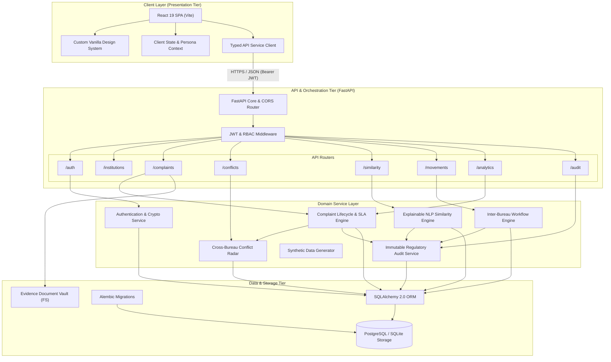
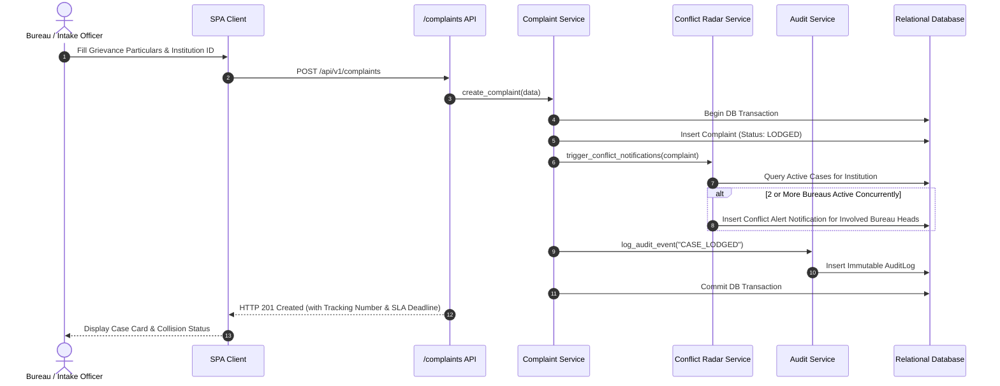
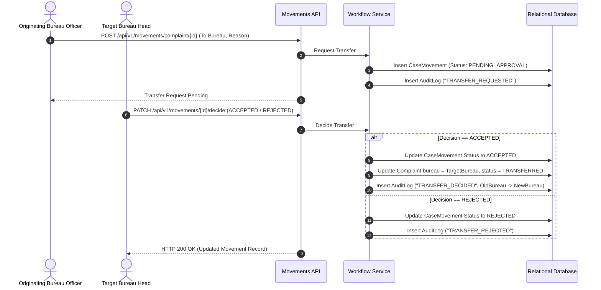
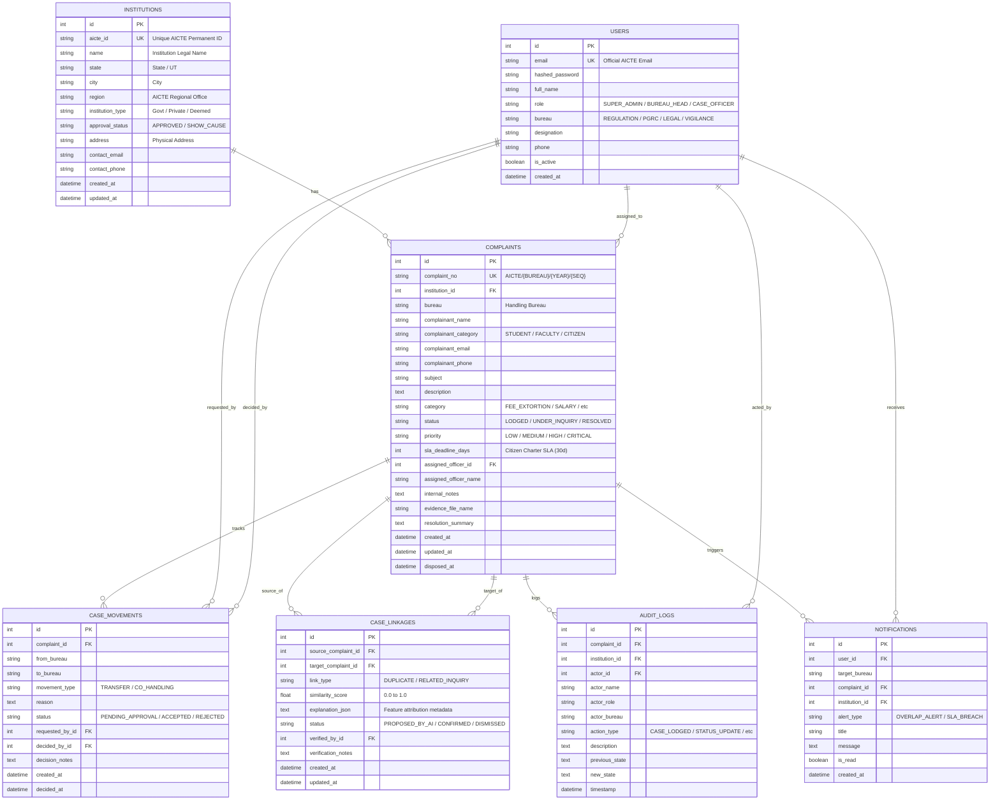

# SAMANVAY (समन्वय) — System Architecture Document
## SIH PS 26264: Integrated Dashboard for Monitoring and Tracking Institution Complaint Cases

---

## 1. Architectural Philosophy & Principles
SAMANVAY is built upon a **Modular Monolithic Clean Architecture** prioritizing:
1. **Single Source of Truth:** A unified relational database where every institution is indexed by its unique AICTE Permanent ID.
2. **Explicit Layer Separation:** Strict separation between Presentation (React SPA), API Gateway / Orchestration (FastAPI), Domain Logic / Services, and Persistence (SQLAlchemy + Alembic).
3. **Transactional Integrity:** State changes, case movements, and audit log generation occur within atomic transactions (`ACID`).
4. **Human-in-the-Loop Explainability:** All machine-learning/similarity suggestions are explainable with clear attribution breakdown, requiring human confirmation.
5. **Portability & Zero-External-Daemon Readiness:** Native dual-dialect database support (PostgreSQL in production environments, SQLite for rapid local verification and CI test suites).

---

## 2. High-Level Component Architecture



---

## 3. Data Flow Architecture

### 3.1 Complaint Registration & Multi-Bureau Collision Detection Flow



### 3.2 Inter-Bureau File Transfer & Co-Handling Flow



---

## 4. Database Schema & Entity-Relationship Model



---

## 5. Explainable AI Similarity & Deduplication Architecture

Under **Rule 14**, machine learning algorithms must operate strictly as explainable assistants under human-in-the-loop oversight.

### 5.1 Multi-Factor Scoring Formula
The composite matching engine combines vector semantic overlap with hard metadata heuristics:

$$\text{Composite Score} = (S_{\text{semantic}} \times 0.55) + (I_{\text{match}} \times 0.30) + (C_{\text{match}} \times 0.15)$$

Where:
* $S_{\text{semantic}} \in [0.0, 1.0]$: Cosine similarity of TF-IDF vectors generated from complaint narrative and subject text.
* $I_{\text{match}} \in \{0.0, 1.0\}$: Binary indicator whether both complaints concern the exact same AICTE Permanent ID.
* $C_{\text{match}} \in \{0.0, 1.0\}$: Binary indicator whether both complaints share the same regulatory grievance category.

### 5.2 Attribution Breakdown Structure
For every evaluated pair, the system generates an immutable explanation object:
```json
{
  "overall_score": 0.865,
  "text_similarity_score": 0.760,
  "category_match": true,
  "institution_match": true,
  "shared_keywords": ["certificates", "caution deposit", "withholding", "marksheet"],
  "rationale": "High match (86.5%): Identical institution (Apex Institute), matching category (FEE_EXTORTION), and 76% semantic overlap highlighting withholding of graduation marksheets until unapproved deposit paid."
}
```

---

## 6. Security, Threat Surface, and Audit Architecture
1. **Append-Only Immutable Audit Log:** Audit log table supports only `INSERT` and `SELECT` via the application layer. No `UPDATE` or `DELETE` methods exist in the service layer.
2. **Encrypted Credentials:** Passwords stored using native salted `bcrypt` hashes.
3. **Stateless JWT Claims:** Tokens contain user ID, expiration, and algorithm signature; permissions are verified dynamically from active DB records on each request.
4. **Document Storage Sandboxing:** Uploaded documents are saved with randomized collision-free hashes and extension validation, outside the web root.
