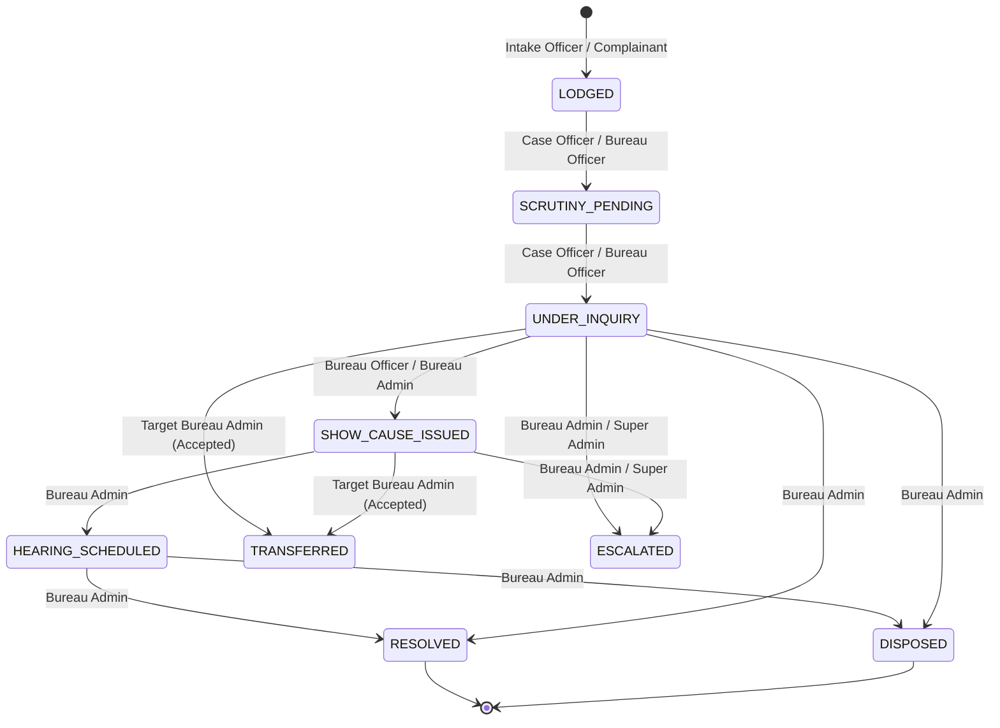

# SAMANVAY (समन्वय) — Role-Based Access Control (RBAC) & Permission Matrix
## SIH PS 26264: Integrated Dashboard for Monitoring and Tracking Institution Complaint Cases

> **Notice:** The roles defined herein represent proposed prototype access controls for technical evaluation and hackathon implementation, and do not supersede or constitute official AICTE statutory service regulations.

---

## 1. Prototype Role Definitions

| Role Identifier | Role Title | Functional Scope | Primary Bureau Affiliation |
| :--- | :--- | :--- | :--- |
| `SUPER_ADMIN` | Super Administrator | Full council-wide oversight, system configuration, arbitration, and cross-bureau visibility | Central Administration / AICTE HQ |
| `BUREAU_ADMIN` | Bureau Administrator | Authority over an entire specific bureau or cell (e.g. Advisor Regulation, Director PGRC) | Any specific Bureau (RB, PGRC, AB, LC, VC, PAPB) |
| `BUREAU_OFFICER`| Bureau Scrutiny Officer| Senior operational officer within a bureau managing queues, drafting notices, transfers | Any specific Bureau |
| `CASE_OFFICER` | Case / Desk Officer | Direct investigative custody over assigned complaints, communication, and evidence | Any specific Bureau |
| `AUDITOR` | Read-Only Auditor | Forensic compliance inspection, SLA tracking, non-mutating audit log review | Independent / Vigilance / Inspection Unit |

---

## 2. Granular Operations & Role-Permission Matrix

Legend:
* **`FULL`**: Unrestricted create, read, update, and manage permissions across all bureaus.
* **`BUREAU`**: Operations permitted strictly within the user's assigned bureau.
* **`ASSIGNED`**: Operations permitted strictly on cases assigned directly to the officer.
* **`READ`**: Read-only access (no creation, modification, or deletion).
* **`NONE`**: Operation strictly prohibited (enforced with HTTP 403 Forbidden).

| Operational Capability | `SUPER_ADMIN` | `BUREAU_ADMIN` | `BUREAU_OFFICER` | `CASE_OFFICER` | `AUDITOR` |
| :--- | :---: | :---: | :---: | :---: | :---: |
| **System & User Administration** | | | | | |
| Create & manage system users | `FULL` | `NONE` | `NONE` | `NONE` | `NONE` |
| Configure SLA deadlines & rules | `FULL` | `NONE` | `NONE` | `NONE` | `NONE` |
| View active sessions & system health | `FULL` | `READ` | `NONE` | `NONE` | `READ` |
| **Institution Registry & Dossier** | | | | | |
| View institution list & metadata | `FULL` | `FULL` | `FULL` | `FULL` | `READ` |
| View 360° Comprehensive Dossier | `FULL` | `FULL` | `FULL` | `FULL` | `READ` |
| Edit institution status (e.g. Show Cause) | `FULL` | `BUREAU` | `NONE` | `NONE` | `NONE` |
| **Complaint Intake & Registration** | | | | | |
| Lodge new complaint in intake portal | `FULL` | `BUREAU` | `BUREAU` | `BUREAU` | `NONE` |
| View unassigned complaints queue | `FULL` | `BUREAU` | `BUREAU` | `NONE` | `READ` |
| View cross-bureau complaint repository | `FULL` | `READ` | `READ` | `READ` | `READ` |
| **Case Assignment & Triage** | | | | | |
| Assign complaint to Case Officer | `FULL` | `BUREAU` | `NONE` | `NONE` | `NONE` |
| Reassign / Revoke case assignment | `FULL` | `BUREAU` | `NONE` | `NONE` | `NONE` |
| Change complaint priority level | `FULL` | `BUREAU` | `BUREAU` | `ASSIGNED` | `NONE` |
| **Inquiry & Lifecycle Transitions** | | | | | |
| Update status: `SCRUTINY_PENDING` | `FULL` | `BUREAU` | `BUREAU` | `ASSIGNED` | `NONE` |
| Update status: `UNDER_INQUIRY` | `FULL` | `BUREAU` | `BUREAU` | `ASSIGNED` | `NONE` |
| Update status: `SHOW_CAUSE_ISSUED` | `FULL` | `BUREAU` | `BUREAU` | `NONE` | `NONE` |
| Update status: `HEARING_SCHEDULED` | `FULL` | `BUREAU` | `BUREAU` | `NONE` | `NONE` |
| Final closure: `RESOLVED` / `DISPOSED` | `FULL` | `BUREAU` | `NONE` | `NONE` | `NONE` |
| Add internal confidential scrutiny notes | `FULL` | `BUREAU` | `BUREAU` | `ASSIGNED` | `NONE` |
| **Inter-Bureau File Transfers** | | | | | |
| Initiate transfer request to another bureau| `FULL` | `BUREAU` | `BUREAU` | `ASSIGNED` | `NONE` |
| Authorize / Decide incoming transfer | `FULL` | `BUREAU` | `NONE` | `NONE` | `NONE` |
| View council-wide transfer registry | `FULL` | `READ` | `READ` | `READ` | `READ` |
| **Conflict Radar & Joint Coordination** | | | | | |
| View Master Cross-Bureau Conflict Radar | `FULL` | `FULL` | `FULL` | `FULL` | `READ` |
| Receive multi-bureau collision alerts | `FULL` | `BUREAU` | `BUREAU` | `ASSIGNED` | `READ` |
| Designate Lead Bureau for joint inquiry | `FULL` | `NONE` | `NONE` | `NONE` | `NONE` |
| Schedule joint inter-bureau hearing | `FULL` | `BUREAU` | `NONE` | `NONE` | `NONE` |
| **Explainable AI Similarity & Linkage** | | | | | |
| Run NLP similarity analysis on a case | `FULL` | `FULL` | `FULL` | `FULL` | `READ` |
| View explainable attribution breakdown | `FULL` | `FULL` | `FULL` | `FULL` | `READ` |
| Confirm linkage (`DUPLICATE` / `RELATED`) | `FULL` | `BUREAU` | `BUREAU` | `ASSIGNED` | `NONE` |
| Dismiss proposed similarity linkage | `FULL` | `BUREAU` | `BUREAU` | `ASSIGNED` | `NONE` |
| **Evidence & Attachments Vault** | | | | | |
| Upload supporting verification document | `FULL` | `BUREAU` | `BUREAU` | `ASSIGNED` | `NONE` |
| Download / View evidence attachment | `FULL` | `FULL` | `FULL` | `ASSIGNED` | `READ` |
| **Analytics, Audit & Privacy** | | | | | |
| View executive KPI dashboard | `FULL` | `FULL` | `FULL` | `FULL` | `READ` |
| View immutable audit trail log | `FULL` | `BUREAU` | `BUREAU` | `ASSIGNED` | `READ (All)` |
| View unredacted complainant contact info | `FULL` | `BUREAU` | `BUREAU` | `ASSIGNED` | `NONE` |
| Export analytical compliance reports | `FULL` | `BUREAU` | `NONE` | `NONE` | `READ` |

---

## 3. Complaint State Transition Authorization Rules

### Detailed Transition Constraints:
1. **`LODGED` $\rightarrow$ `SCRUTINY_PENDING` / `UNDER_INQUIRY`:** Can be triggered upon assigning a desk officer or beginning initial file examination.
2. **`UNDER_INQUIRY` $\rightarrow$ `SHOW_CAUSE_ISSUED`:** Requires formal draft of allegations and administrative sanction by a Bureau Officer or Bureau Administrator.
3. **`SHOW_CAUSE_ISSUED` $\rightarrow$ `HEARING_SCHEDULED`:** Requires official hearing date, time, and standing committee room/link details.
4. **Any State $\rightarrow$ `RESOLVED` or `DISPOSED`:** Strictly restricted to `BUREAU_ADMIN` and `SUPER_ADMIN`. Mandatory **Official Disposal Summary** required in request payload.
5. **Any State $\rightarrow$ `TRANSFERRED`:** Can only be finalized when target Bureau Administrator executes `PATCH /movements/{id}/decide` with `decision = ACCEPTED`.
