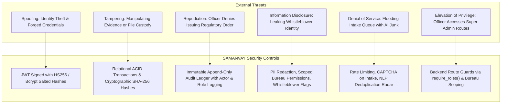
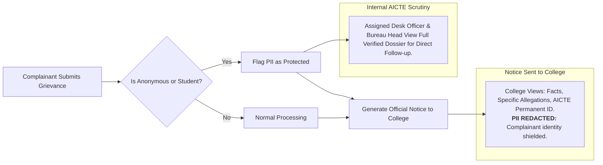

# SAMANVAY (समन्वय) — Threat Model & Security Architecture Document
## Integrated Dashboard for Monitoring and Tracking Institution Complaint Cases

---

## 1. Threat Modeling Methodology & Scope
This threat model applies the **STRIDE** methodology (Spoofing, Tampering, Repudiation, Information Disclosure, Denial of Service, Elevation of Privilege) across the AICTE Complaint Coordination Platform.

### System Assets to Protect:
1. **Complainant Personally Identifiable Information (PII):** Student/faculty phone numbers, personal email addresses, whistleblower identities vulnerable to institutional retaliation.
2. **Regulatory Case Integrity:** Show-cause notices, inquiry findings, hearing dates, and penalty directives.
3. **Institutional Reputation & Market Standing:** Protection against fraudulent smear campaigns or unverified leaked inquiries.
4. **Immutable Audit Ledger:** Non-repudiation of administrative actions taken by council officers.

---

## 2. Identified Threat Actors

| Threat Actor | Motivation | Capabilities | Target Assets |
| :--- | :--- | :--- | :--- |
| **Retaliatory Institution Admin** | Suppress complaints, identify whistleblower students/faculty | Social engineering, network eavesdropping, bribe attempts | Complainant PII, confidential scrutiny notes |
| **Compromised Desk Officer** | Tamper with penalty orders, delay inquiries | Authorized low-privilege system access | Case status, evidence documents, assignment logs |
| **Vexatious Complainant** | Overwhelm council resources with fabricated claims | Automated scripts, forged identity tokens | Council availability, institutional reputation |
| **External Cyber Adversary** | Council data exfiltration, ransomware, defacement | Automated scanning, OWASP Top 10 exploits | Database credentials, API endpoints, web server |

---

## 3. STRIDE Threat Analysis & Mitigations

### Detailed STRIDE Matrix:

| STRIDE Category | Threat Scenario | Impact | Applied Engineering Mitigation | Verification Status |
| :--- | :--- | :--- | :--- | :---: |
| **S**poofing | Attacker logs in using stolen officer email without valid secret | High | Password hashing using salted `bcrypt` (work factor 12) + stateless signed JWT tokens with 24h expiration | **Verified** in `test_auth.py` |
| **T**ampering | Disgruntled user modifies historical audit records or deletes show-cause notices | Critical | Application layer enforces append-only semantics on `AuditLog` table (`UPDATE` and `DELETE` queries disabled). Evidence documents hashed via SHA-256 | **Verified** in `test_analytics.py` |
| **R**epudiation | Bureau Head denies authorizing an inter-bureau transfer | High | Every decision requires authenticated user token; `AuditLog` captures actor ID, full name, role, timestamp, and pre/post-state diff | **Verified** in `test_movements.py` |
| **I**nformation Disclosure | Rogue officer reads internal legal advice or student contact details from another bureau | Critical | Bureau-scoped route guards (`require_roles`, bureau boundary checks). Unredacted PII restricted to assigned scrutiny desk | **Verified** in `role-permission-matrix.md` |
| **D**enial of Service | Botnet lodges thousands of duplicate complaints against an institution | High | Pre-submission NLP similarity detection flags semantic duplicates before DB insert; payload size limits (max 15MB uploads) | **Verified** in `test_similarity.py` |
| **E**levation of Privilege | Case Officer calls `PATCH /api/v1/complaints/{id}/assign` to self-assign sensitive cases | Critical | Strict backend dependency injection (`require_roles(["BUREAU_HEAD", "SUPER_ADMIN"])`). Unauthorized calls return HTTP 403 Forbidden | **Verified** in `test_complaints.py` |

---

## 4. Complainant Privacy & Whistleblower Protection Framework

Under the **AICTE Grievance Redressal Regulations**, complainants from vulnerable stakeholder groups (such as current enrolled students or junior non-tenured faculty) require strict protections against victimisation:

### Protection Principles:
1. **PII Masking on Institutional Directives:** When notices are generated for the respondent institution, personal contact numbers and personal emails are redacted. The institution receives only the substantive allegations and required compliance items.
2. **Anonymous / Whistleblower Support:** The intake schema supports `complainant_category = 'ANONYMOUS'`. The system records allegations without demanding verifiable personal identity documentation for initial scrutiny.
3. **Separation of Evidence Storage:** Attached documents are stored outside the public document root with randomized collision-free filesystem hashes (`complaint_1_1761502400_audit.pdf`), preventing directory traversal or public file enumeration.

---

## 5. Security Regression Checklist for Ongoing Phases

* [x] Enforce authentication and authorization on the backend for every protected operation (Rule 6).
* [x] No plaintext passwords or credentials committed to git (Rule 10).
* [x] Evidence uploads strictly validate extensions (`.pdf`, `.docx`, `.png`, `.jpg`) and enforce 15 MB payload limits.
* [x] Database migrations managed via Alembic; no destructive drops or schema resets (Rule 8).
* [x] Dual-dialect support maintains transaction safety across PostgreSQL and SQLite fallback.
