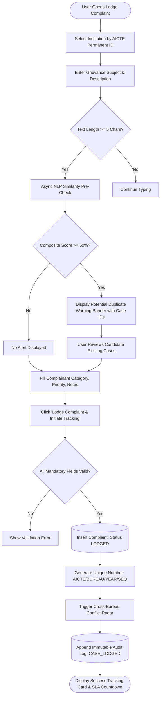
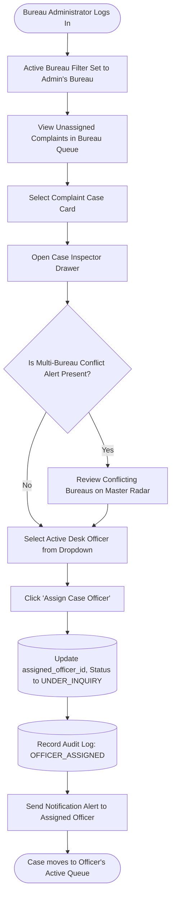
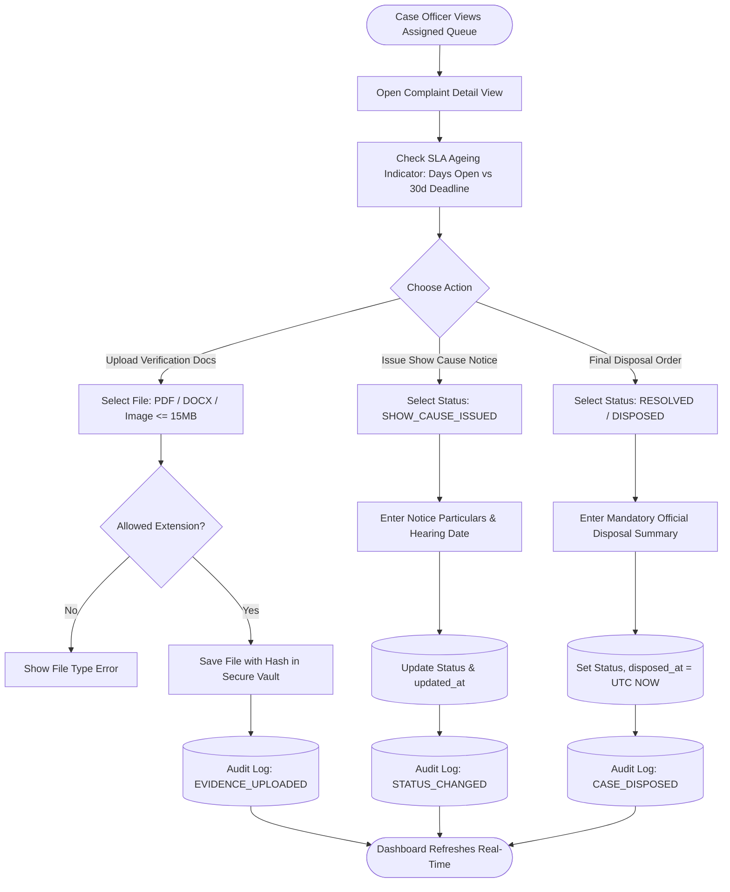
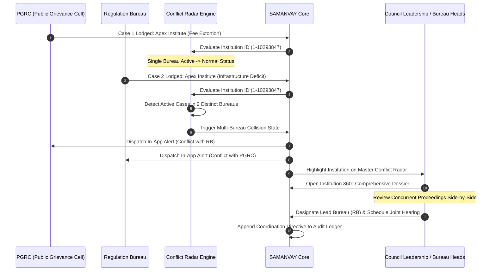
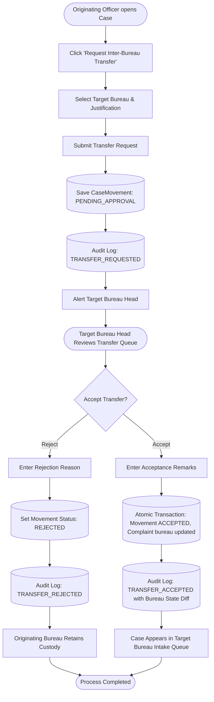
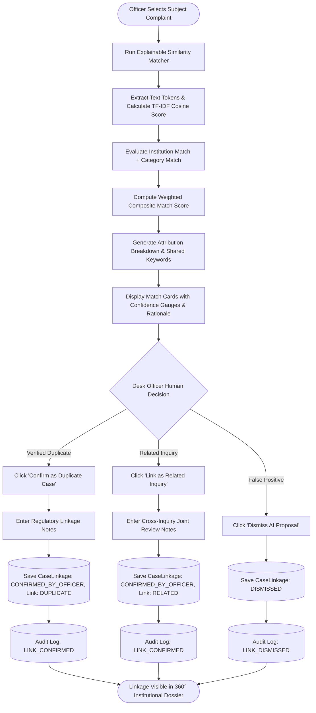
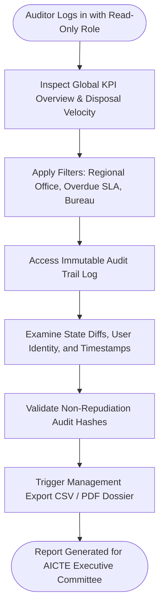

# SAMANVAY (समन्वय) — End-to-End User Flows Document
## Integrated Dashboard for Monitoring and Tracking Institution Complaint Cases

---

## 1. Flow 1: Complaint Registration with Live Duplicate Pre-Check

### Objective
Allow a complainant, student, faculty member, or intake officer to register a complaint while automatically checking for existing identical or overlapping complaints before submission to prevent redundant files.

---

## 2. Flow 2: Bureau Administrator Triage & Desk Officer Assignment

### Objective
Bureau Administrator (Head of Regulation Bureau, Director PGRC, etc.) reviews incoming complaints in their bureau queue and assigns responsibility to a specific Case Officer.

---

## 3. Flow 3: Case Officer Inquiry, Evidence Upload & Status Transition

### Objective
Case Officer conducts inquiry, requests clarifications from the institution, uploads inspection/verification evidence, and transitions case through official regulatory lifecycle stages.

---

## 4. Flow 4: Cross-Bureau Overlap Detection & Joint Resolution Conference

### Objective
Identify concurrent actions by multiple bureaus (e.g. PGRC and Regulation Bureau) on the same institution, alerting bureau heads to synchronize and avoid contradictory regulatory orders.

---

## 5. Flow 5: Inter-Bureau File Transfer & Co-Handling Workflow

### Objective
Transfer an institution's case file from one bureau to another (e.g. from PGRC to Vigilance Cell upon discovering forged documentation) with formal administrative authorization.

---

## 6. Flow 6: Explainable AI Similarity Matching & Human-in-the-Loop Review

### Objective
Ensure machine-learning similarity suggestions are transparent, explainable, and subject to formal human officer verification under Rule 14.

---

## 7. Flow 7: Read-Only Auditor Forensic Inspection & Regulatory Reporting

### Objective
Allow internal auditors, compliance inspectors, and council leadership to examine the complete immutable timeline and export reports without risk of mutating regulatory data.

